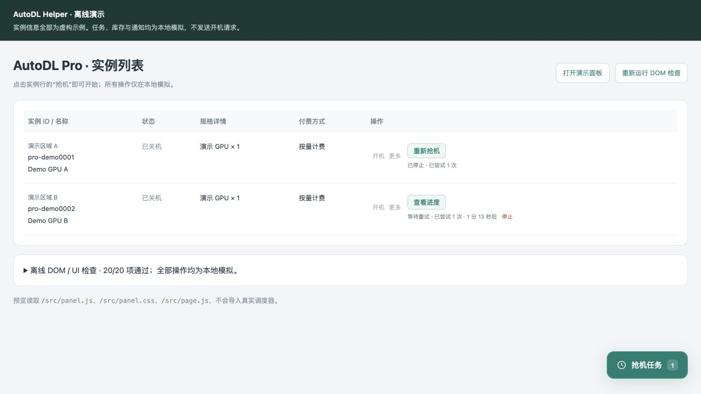
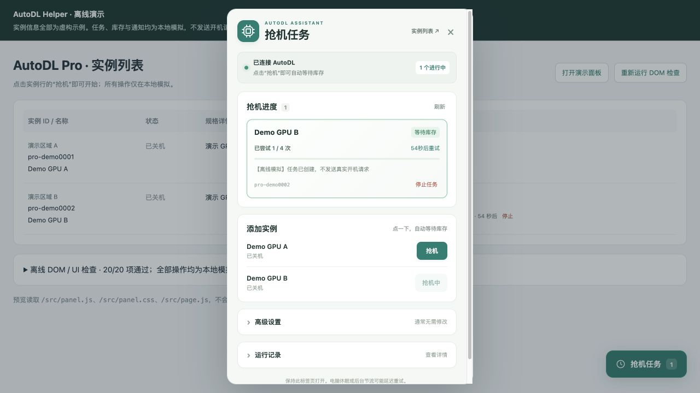

# AutoDL Helper

在 AutoDL 实例页面一键添加抢机任务，自动等待库存，直接查看进度。

[安装脚本](https://raw.githubusercontent.com/zgx949/autodl-helper/main/autodl-scheduler.user.js) · [详细安装](docs/INSTALLATION.md) · [使用指南](docs/USAGE.md) · [常见问题](docs/FAQ.md) · [更新记录](CHANGELOG.md)

[](https://github.com/zgx949/autodl-helper/actions/workflows/ci.yml)
[](LICENSE)

**无需抓包，无需填写鉴权和实例 ID，也无需部署服务器。** 安装游猴脚本后，在现有实例行点击“抢机”即可开始。开始时间、重试间隔等选项默认收在高级设置中。

## 功能

- **一键抢机**：从当前页面识别实例和登录状态，默认立即尝试、每 60 秒重试库存不足，次数不限。
- **行内进度**：在实例旁查看当前状态、尝试次数、下次重试倒计时，直接停止任务。
- **集中管理**：通过“抢机任务”面板查看多个实例；重复点击运行中的任务只查看进度。
- **关机后可再次抢机**：按页面当前实例状态决定能否开始，历史“开机已受理”记录不会锁住已关机的实例；结束记录可在实例行或面板删除。
- **高级设置**：可预约开始时间、修改间隔、限制尝试次数，设置对之后添加的任务生效。
- **结果通知**：提供浏览器通知，可选配置 WxPusher 微信通知。
- **明确结束条件**：只把接口明确返回成功记为“已受理”；鉴权失效、未知业务错误或结果不明的网络超时会停止并提示检查。
- **单文件、零运行依赖**：不加载远程 JavaScript；源代码、测试和构建脚本随仓库提供。

## 界面预览

下图来自离线演示，使用虚构实例和模拟结果，没有调用真实开机接口。

### 实例行直接抢机



### 任务进度面板



## 快速开始

1. 在 Chrome 中安装并启用 [Tampermonkey](https://www.tampermonkey.net/)，按需在扩展详情中开启“允许用户脚本”。详见[官方说明](https://www.tampermonkey.net/faq.php#Q209)。
2. 点击 **[安装 AutoDL Helper](https://raw.githubusercontent.com/zgx949/autodl-helper/main/autodl-scheduler.user.js)**，在游猴安装页确认安装。如果浏览器只显示源码，按[手动安装步骤](docs/INSTALLATION.md#方式二手动复制安装)粘贴保存。
3. 登录并打开 [AutoDL 普通实例列表](https://www.autodl.com/console/instance/list)或 [Pro 实例列表](https://www.autodl.com/console/instance/pro/list)，刷新页面。
4. 在目标实例行点击 **“抢机”**。无需填写内容，任务立即开始；页面会显示次数和倒计时。
5. 在原实例行点击 **“停止”**，或通过右下角 **“抢机任务”** 查看和管理全部任务。任务结束后可点 **“删除记录”**；实例关机后可直接重新抢机，无需先删历史记录。

普通使用者不需要安装 Node.js、Python，也不需要克隆仓库。使用过早期“AutoDL 定时抢机”脚本的用户，请先停用旧版，避免与本项目公开版同时运行。

## 使用前了解

| 项目 | 当前行为 |
| --- | --- |
| 支持范围 | 个人账户下已有 **普通与 Pro 实例的开机重试**；不创建或租用新实例，暂不支持子账户 |
| 默认方式 | 立即尝试；库存不足时每 60 秒重试；次数不限 |
| 页面运行 | 保持执行任务的 AutoDL 标签页打开；电脑休眠会暂停执行，后台节流可能延迟重试 |
| 刷新与重启 | 原运行任务会暂停，确认后手动重新启动；不会静默恢复开机请求 |
| 多标签页 | 普通与 Pro 页面均可操作，由一个持锁标签页统一执行；执行页关闭后自动接管，旧活跃任务暂停 |
| 成功含义 | “开机已受理”表示接口接受请求；实例是否已运行，以 AutoDL 控制台为准 |
| 再次使用 | 实例关机后，即使保留上次成功记录也可重新抢机；页面显示已运行或启动中时不能新增抢机任务 |
| 删除记录 | 结束任务可在实例行或面板删除；活跃任务先停止，删除记录不影响 AutoDL 实例 |

这是基于浏览器页面运行的辅助脚本，不保证库存获取成功或秒级准点。开机可能产生 AutoDL 正常使用费用，请自行确认实例配置及账户状态。项目为社区工具，与 AutoDL 官方无隶属关系。

## 高级设置与通知

打开右下角“抢机任务” → 展开“高级设置”即可配置。通常无需修改：

- **开始时间**：留空立即开始；使用电脑本地时间。预约时间过期后，新任务恢复为立即开始。
- **重试间隔**：默认 60 秒，可设为 0–86400 秒，支持小数；0 表示收到响应后不额外等待。
- **最多尝试**：默认 0，表示不限；也可指定 1–100000 次。
- **微信通知**：可填写自己的 WxPusher SPT；只在开机请求受理后发送。
- **手动实例 ID**：仅作为页面未识别实例时的备用入口。

保存设置不会修改已经运行的任务。如需调整某个运行任务，先停止，再重新添加。详细步骤和状态解释见[使用指南](docs/USAGE.md)。

## 数据与权限

脚本从当前 AutoDL 页面读取登录鉴权，并仅向 AutoDL 发送对应实例的开机请求。脚本不会额外持久化鉴权；可选的 WxPusher SPT 也只保存在当前页面内存中，刷新后需要重新填写。

任务配置、关联账户标识、已识别实例和近期脱敏记录保存在游猴存储中。启用微信通知后，实例名称、ID 和请求受理信息会发送给 WxPusher。不开启时不会向 WxPusher 发送消息。

仓库中的测试、演示数据和截图均为虚构内容。反馈问题时，请勿提交 Cookie、Authorization、SPT 或完整账号页面。完整说明见[安全与隐私说明](SECURITY.md)。

## 文档

| 文档 | 内容 |
| --- | --- |
| [安装指南](docs/INSTALLATION.md) | 游猴准备、一键安装、手动安装、更新与卸载 |
| [使用指南](docs/USAGE.md) | 一键抢机、状态解释、预约、次数限制、通知与数据 |
| [常见问题](docs/FAQ.md) | 按钮不出现、鉴权失效、只读标签页、超时和通知故障 |
| [贡献指南](CONTRIBUTING.md) | 本地开发、测试、离线预览与提交规范 |
| [更新记录](CHANGELOG.md) | 版本功能与行为变化 |

## 本地开发

要求 **Node.js 22 或更新版本**。项目不依赖第三方 npm 包，无需执行 `npm install`。

```sh
git clone https://github.com/zgx949/autodl-helper.git
cd autodl-helper
npm run validate
```

验证命令会构建并检查产物、运行模拟逻辑测试。发布前另运行公开文件检查；也可以分别运行以下步骤：

```sh
npm run build
npm run check
npm test
npm run check:public
```

`autodl-scheduler.user.js` 是可安装的构建产物。修改 `src/` 后运行构建，并将构建产物一并提交。

可选离线预览需要 Python 3，全部操作使用虚构实例和模拟接口：

```sh
npm run preview
```

打开 <http://127.0.0.1:8765/preview/index.html> 查看界面和浏览器交互检查。离线预览不会调用 AutoDL 开机接口，也不会发送微信。也可运行 `python3 scripts/preview.py --serve --port 8765`。

```text
autodl-helper/
├── autodl-scheduler.user.js   # 可直接安装的单文件脚本
├── src/                     # 核心逻辑、调度器、面板和游猴适配
├── tests/
│   └── fixtures/            # 虚构实例页面
├── scripts/                 # 构建、检查、离线预览
├── docs/                    # 安装、使用、排障和演示截图
└── .github/                 # 持续集成与社区协作模板
```

自动化测试覆盖响应判断、配置校验、重试退避、停止竞态、账户切换、刷新暂停和页面交互。测试使用模拟请求，不代表已完成真实账户开机验证；AutoDL 页面或接口变化时可能需要适配。

## 反馈与贡献

欢迎通过 [Issues](https://github.com/zgx949/autodl-helper/issues) 报告可复现问题、提出建议，或按[贡献指南](CONTRIBUTING.md)提交 Pull Request。敏感问题请按 [SECURITY.md](SECURITY.md) 处理。

## 许可证

本项目使用 [MIT License](LICENSE)。
